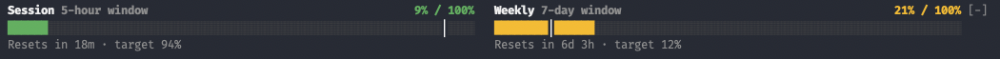

# usage-gauge

A Claude Code mod that draws your plan's rate-limit usage in the band directly above the prompt: the 5-hour session window and the 7-day weekly window, side by side.



Each gauge shows:

- **Current usage and maximum**: `percentUsed / 100%`, as the API reports it. The API reports a percentage only, so the maximum is always 100%.
- **Pace target**: the `│` marker and `target N%`, the share of the window that has already elapsed, `(window length - time until reset) / window length`. Usage left of the marker is under pace.
- **Reset time**: `Resets in …`, counted from the window's `resetsAt`.

The fill is `success` while usage is at or under the target, `warning` above it, and `error` from 90%.

Each session reads the values the API reported on its own last response: `$.session.usage()` at session start and every 60 seconds, and each `session.measure` event (each turn, and whenever a window moves a whole point). The sessions share their readings through the plugin's store, so every session draws the newest one: for each window, the reading with the later `resetsAt`, or within one window the higher `percentUsed`. The reset countdown and the target are recomputed every 60 seconds.

Once a window's `resetsAt` has passed and no session has read the new window yet, the gauge shows `-% / 100%` and `Reset · waiting for the next response`.

## Command

- `/usage-gauge refresh` reads the values again at once, merges them with the other sessions' readings and prints them. It sends no API request: the values change only when some session receives a response.

## Install

At the prompt of a terminal session:

```
/plugin install usage-gauge --marketplace hwanyong/usage-gauge
```

From a shell:

```
claude plugin install usage-gauge --marketplace hwanyong/usage-gauge
```

In the desktop app: click + next to the prompt box, then Plugins, Add marketplace with `hwanyong/usage-gauge`, then Add plugin.

## Limits

- Rate limits exist only on a Claude subscription. With an API key, Bedrock or Vertex, `rateLimits` is empty and the band is not drawn.
- The band appears once any session has a reading: at once when an earlier session stored one, otherwise after this session's first API response.
- Per-model weekly windows (such as the one `/usage` lists by model name) are not exposed to mods, so they are not shown.
- The band draws on the terminal and desktop surfaces only.

## License

MIT
